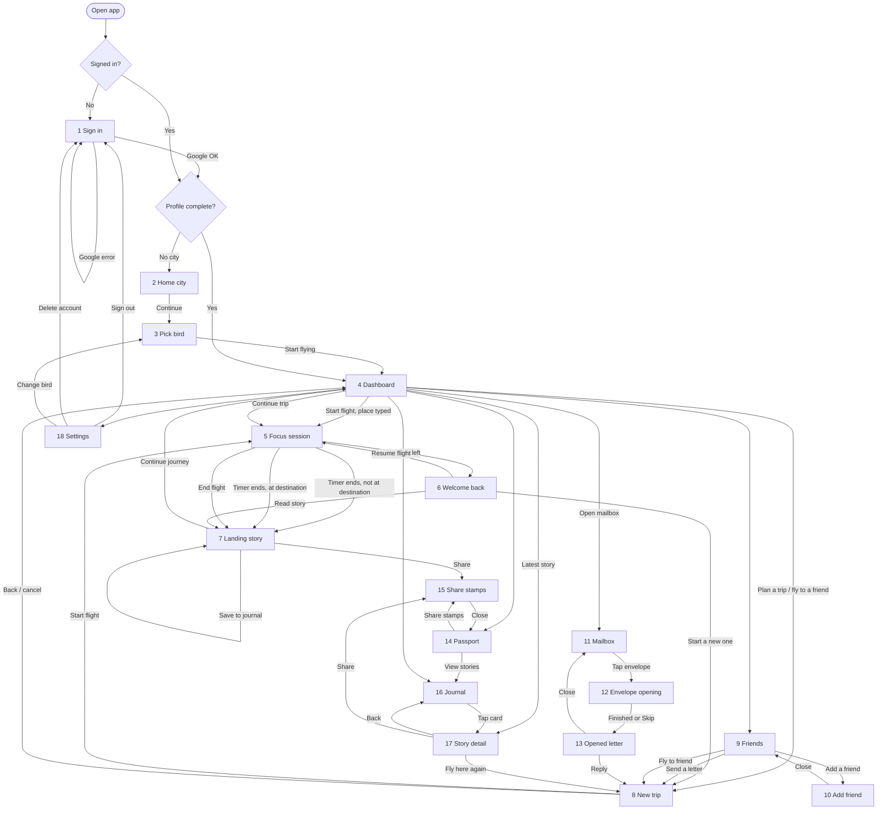
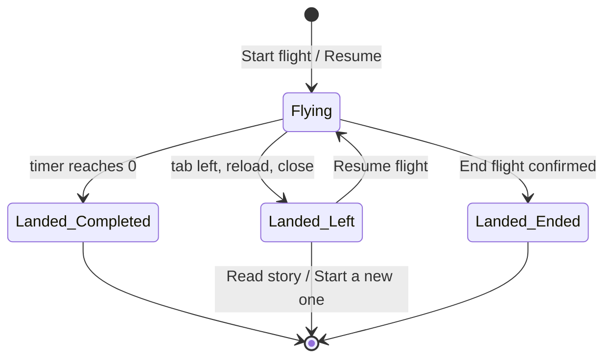
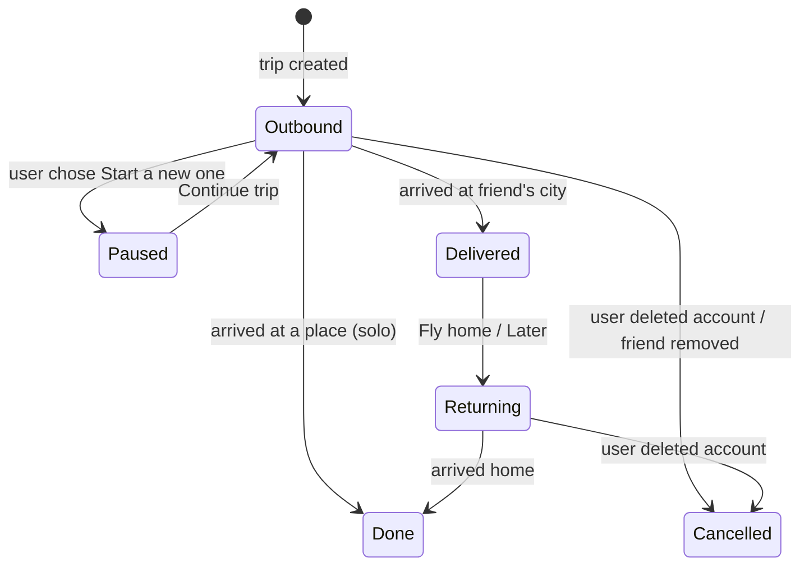
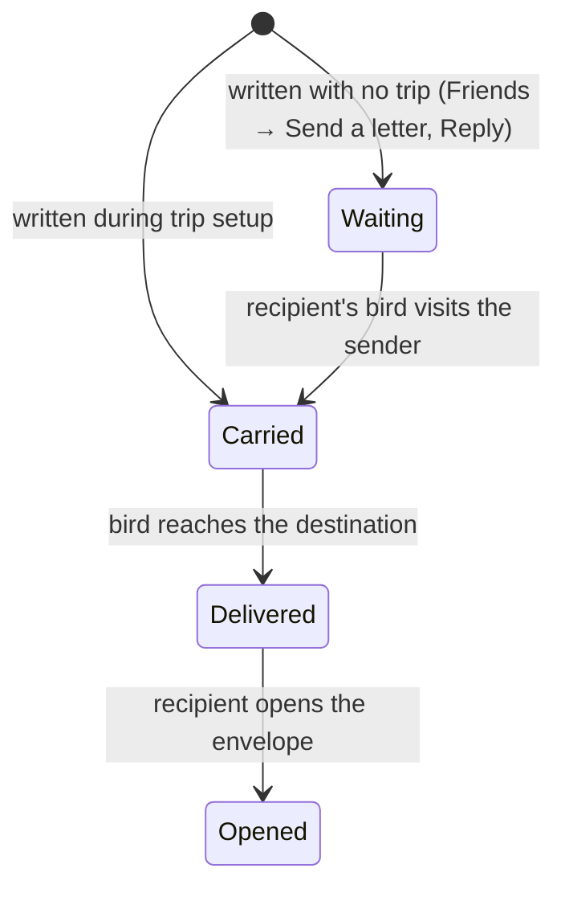

# Pigeon Post: App Flow

Covers the 18 screens in `Peigon Post_Screens.md`: every route, every redirect between screens, the state machines behind them, and the full user journeys.

Decisions I made where the spec was silent are marked **(decision)**. Change any of them and the flow below needs a matching edit.

---

## 1. Screen and route map

| # | Screen | Route | Type |
|---|---|---|---|
| 1 | Sign in | `/signin` | Page |
| 2 | Home city | `/onboarding/city` | Page |
| 3 | Pick your bird | `/onboarding/bird` | Page (also reused as a modal from Settings) |
| 4 | Dashboard | `/home` | Page (default after login) |
| 5 | Focus session | `/fly/:tripId` | Full screen, no nav bar |
| 6 | Welcome back | `/fly/:tripId?back=1` | Overlay on the focus map |
| 7 | Landing story card | `/landing/:storyId` | Full card page |
| 8 | New trip and letter composer | `/trip/new` | Page, 3 steps (`?step=1..3`) |
| 9 | Friends | `/friends` | Page (tabs: Friends, Requests) |
| 10 | Add a friend | `/friends/add` | Modal over Friends |
| 11 | Mailbox | `/mailbox` | Page |
| 12 | Envelope opening | `/mailbox/:letterId/opening` | Full-screen sequence |
| 13 | Opened letter | `/mailbox/:letterId` | Page |
| 14 | Passport | `/passport` | Page |
| 15 | Share stamps | `/passport/share` | Modal (also opened from Journal detail) |
| 16 | Journal | `/journal` | Page (tabs: All, Saved) |
| 17 | Journal story detail | `/journal/:storyId` | Page |
| 18 | Settings | `/settings/:section` | Page (sections: profile, city, birds, sound, notifications, privacy, account) |

Not screens: the top nav bar (desktop) and bottom tab bar (mobile) link to Home, Mailbox, Friends, Passport, Journal. The avatar menu links to Settings and Sign out. The sound toggle is global.

---

## 2. Global rules (apply on every navigation)

1. **Auth guard.** No valid session → `/signin`, remembering the requested URL as `returnTo`. After sign-in, go to `returnTo` if the profile is complete.
2. **Onboarding guard.** Signed in but no home city → `/onboarding/city`. City set but no bird → `/onboarding/bird`. Both set → `/home` (or `returnTo`). Visiting `/signin` or `/onboarding/*` when already complete → `/home`.
3. **Active-session guard.** If a flight is running (`/fly/:tripId`), the nav bar is hidden and every other route redirects back to `/fly/:tripId`. The only exits are **End flight**, completing, or leaving the tab.
4. **Leaving the tab** (tab hidden, window blur, page reload, browser close) during a flight freezes progress at that moment. The next time the app is visible the user lands on **Welcome back** (screen 6).
5. **Deep links.** Every route above can be opened directly. If the data does not exist or belongs to someone else (a letter, story or trip), show a "Not found" state with a button to `/home`.
6. **Offline.** An offline banner shows on every page. A flight keeps running because progress is computed from the clock. Saves, sends and story loads are queued or show "Try again when you're back online".
7. **Sound.** The header sound toggle mutes the coo, paper rustle and flight ambience everywhere; Settings has the finer controls.
8. **Back button.** Browser back follows the path the user took, except it never returns into an active flight or a closed envelope sequence.

---

## 3. Master flow

---

## 4. Transitions by screen

Format: **Trigger → destination**, with the condition when there is one. "Stay" means the same screen updates in place.

### 1. Sign in (`/signin`)
| Trigger | Destination |
|---|---|
| Continue with Google, success, new user | 2 Home city |
| Continue with Google, success, returning user with complete profile | `returnTo` or 4 Dashboard |
| Continue with Google, success, profile incomplete | 2 Home city (no city) or 3 Pick bird (no bird) |
| Google cancelled or popup blocked | Stay, show "Couldn't sign in. Try again." |
| Already signed in on load | Skip this screen per the guard |
| Terms / Privacy links | Open in a new tab (static pages) |

### 2. Home city (`/onboarding/city`)
| Trigger | Destination |
|---|---|
| Continue (city chosen) | 3 Pick bird |
| Back | 1 Sign in (signs the user out of the onboarding step only; session is kept, user lands here again on next visit) |
| No results | Stay, show the no-results message |
| Reached from Settings → City | Continue returns to 18 Settings (city section) with a saved toast |

### 3. Pick your bird (`/onboarding/bird`)
| Trigger | Destination |
|---|---|
| Start flying | 4 Dashboard (first-time empty state) |
| Back | 2 Home city |
| Reached as a modal from Settings → Birds | "Save" returns to 18 Settings (birds section) |
| Search with no match | Stay, show "No bird by that name yet." |

### 4. Dashboard (`/home`)
| Trigger | Destination |
|---|---|
| Start flight (a place typed, no active trip) | Creates a trip → 5 Focus session |
| Start flight (no place typed) | Stay, focus the "Where to?" field |
| Place suggestion selected | Stay, fills the field and previews distance |
| Continue trip (trip in progress) | 5 Focus session (next leg) |
| Plan a trip / Fly to a friend link under the timer | 8 New trip, step 2 |
| Trip card with status Returning home | 5 Focus session (return leg) |
| Mailbox widget → Open mailbox | 11 Mailbox |
| Latest story card | 17 Story detail |
| Travel activity tiles | Places → 16 Journal; Countries → 14 Passport; Distance and hours → stay (tooltip) |
| Nav bar items | 4, 11, 9, 14, 16 per the nav |
| Avatar menu | 18 Settings, or sign out → 1 |
| Offline | Stay, show banner; Start flight stays enabled (flight can run offline) |

### 5. Focus session (`/fly/:tripId`)
| Trigger | Destination |
|---|---|
| Timer reaches zero | 7 Landing story (reason: completed) |
| Tab hidden, window blurred, reload or close | Progress freezes → on return 6 Welcome back |
| End flight (confirm dialog "Land here?") | 7 Landing story (reason: ended) |
| Nav links | Not available |
| Sound toggle | Stay |
| Final minute | Stay, timer pulses; bird descends in the last seconds |

### 6. Welcome back (`/fly/:tripId?back=1`)
| Trigger | Destination |
|---|---|
| Resume flight | 5 Focus session, same trip, restarts at base speed from the resting spot |
| Read story (tap the preview) | 7 Landing story |
| Start a new one | 8 New trip, step 2. The current trip stays saved as "paused" and appears on 4 Dashboard under Continue trip **(decision)** |
| New stamp icon | 14 Passport, opening that stamp's popover |
| Close the overlay without choosing | Same as Resume flight is **not** assumed: stays on this card until a button is pressed |

### 7. Landing story card (`/landing/:storyId`)
| Trigger | Destination |
|---|---|
| Continue journey, trip not finished | 4 Dashboard with the trip card highlighted and Continue trip ready |
| Continue journey, trip reached its destination (solo) | 4 Dashboard; trip becomes done and the bird goes home **(decision)** |
| Continue journey, destination was a friend | Shows the arrival summary (letters delivered, replies picked up). Primary button becomes **Fly home** → 5 Focus session (return leg). A secondary link "Later" → 4 Dashboard with status Returning home |
| Continue journey, return leg finished at home | 11 Mailbox if replies arrived; otherwise 4 Dashboard |
| Save to journal | Stay, button toggles to Saved |
| Share | 15 Share stamps (modal, preselected to this country and story) |
| Sound icon | Stay, plays the coo |
| New stamp animation | Stay; tapping the stamp → 14 Passport |
| Story failed to load | Stay, show a plain Wikipedia-based card with a Retry link |

### 8. New trip and letter composer (`/trip/new`)
| Trigger | Destination |
|---|---|
| Step 1 → Next | Step 2 (skipped when a bird is already chosen and the user came from a prefilled link) |
| Step 2 → Next, destination is a place | Skips step 3 → Start flight |
| Step 2 → Next, destination is a friend | Step 3 letter |
| Step 3 → Skip letter | Start flight with no letter |
| Start flight | Creates the trip → 5 Focus session |
| Back | Previous step; from step 1 back to wherever the user came from (Dashboard, Friends, Welcome back, Letter, Journal detail) |
| Change bird link | 3 Pick bird (modal), returns here |
| Reached from Friends → Send a letter | Opens step 3 only, saves the letter as WAITING, then → 11 Mailbox (Sent by me) with a banner "Fly to Maya to deliver it" linking back here with that friend prefilled |
| Reached from Letter → Reply | Step 3 only, recipient locked to the sender, same rule as above |
| Reached from Journal detail → Fly here again | Step 2 with the place prefilled |
| File too large or wrong type | Stay, show error chip |
| Dictation | Stay, fills the text area |

### 9. Friends (`/friends`)
| Trigger | Destination |
|---|---|
| Add a friend | 10 Add friend (modal) |
| Send a letter on a row | 8 New trip, step 3, recipient locked |
| Fly to friend on a row | 8 New trip, step 2, destination = friend's city |
| Map icon on a row | Stay, expands the mini map |
| Incoming bird banner on a row | Stay, expands the mini map showing the approaching bird |
| Accept / Decline on a request | Stay, row moves or disappears |
| Empty state button | 10 Add friend |

### 10. Add a friend (`/friends/add`)
| Trigger | Destination |
|---|---|
| Copy link / Share | Stay |
| Find friend, code valid | Stay, shows the result card |
| Send request | Stay, shows "Request sent", then Close → 9 Friends (Requests tab) |
| Invalid code, already friends | Stay, show message |
| Close (x) or outside click | 9 Friends |
| Open an invite link while signed out | 1 Sign in, then after onboarding → 9 Friends with this modal open and the code prefilled |

### 11. Mailbox (`/mailbox`)
| Trigger | Destination |
|---|---|
| Tap an unopened or opened envelope | 12 Envelope opening (opened letters skip the animation and go straight to 13) |
| Tap a "Sent by me" envelope | Stay, shows its status in a small popover (Waiting for a bird, In flight) |
| Returning-home banner | 5 Focus session (return leg) or 4 Dashboard if no leg is ready |
| Filter pills | Stay |
| Empty state | Stay |

### 12. Envelope opening (`/mailbox/:letterId/opening`)
| Trigger | Destination |
|---|---|
| Sequence finishes | 13 Opened letter |
| Skip | 13 Opened letter |
| Browser back | 11 Mailbox, letter stays unopened |

### 13. Opened letter (`/mailbox/:letterId`)
| Trigger | Destination |
|---|---|
| Reply | 8 New trip, step 3, recipient locked |
| Save | Stay, toast "Saved" |
| Close letter | 11 Mailbox, envelope now shown as opened |
| Download attachment | Stay, downloads the file |
| Letter not yours or missing | Not-found state → 11 Mailbox |

### 14. Passport (`/passport`)
| Trigger | Destination |
|---|---|
| Tap a stamp → View stories | 16 Journal filtered by that country |
| Share stamps | 15 Share stamps |
| Filter / sort / Show unvisited | Stay |
| Empty state | 4 Dashboard (button "Start your first flight") |

### 15. Share stamps (`/passport/share`)
| Trigger | Destination |
|---|---|
| Download image | Stay, downloads the PNG |
| Share to Instagram | Opens the device share sheet (mobile) or downloads (desktop), then stays |
| Copy link | Stay, toast |
| Close | Returns to whichever screen opened it (14 Passport, 7 Landing, or 17 Story detail) |

### 16. Journal (`/journal`)
| Trigger | Destination |
|---|---|
| Tap a story card | 17 Story detail |
| Sound icon on a card | Stay |
| Saved tab, filters, sort, search | Stay |
| Empty state | 4 Dashboard |

### 17. Journal story detail (`/journal/:storyId`)
| Trigger | Destination |
|---|---|
| Back arrow | 16 Journal, same filters and scroll position |
| Previous / Next | 17 with the neighbouring story |
| Fly here again | 8 New trip, step 2, place prefilled |
| Share | 15 Share stamps, preselected to this story |
| Save | Stay |
| Story deleted or missing | Not-found state → 16 Journal |

### 18. Settings (`/settings/:section`)
| Trigger | Destination |
|---|---|
| Section links | Stay, switch section |
| Home city → pick a city → Save | Confirm dialog "Changing it affects where your bird starts and returns." → Save → stays with toast; an active trip keeps its old origin |
| Birds → Change bird | 3 Pick bird (modal) → Save → back here |
| Sign out | 1 Sign in |
| Delete my account → confirm | Server deletes data → 1 Sign in with the message "Your account was deleted." |
| Unsaved changes + leave | Prompt "Save changes?" |

---

## 5. User journeys

### Journey A: First time (solo)
1. Opens the app → **1 Sign in** → Continue with Google.
2. **2 Home city** → types "Hyd…", picks Hyderabad, Continue.
3. **3 Pick bird** → chooses origami crane, names it, Start flying.
4. **4 Dashboard** (first-time empty state "Where shall we go first?"). Types "Lisbon", picks the 25 minute chip, Start flight.
5. **5 Focus session**. The bird flies at 100 km per minute for 25 minutes.
6. Timer ends → **7 Landing story** (somewhere in Turkey, say). New country, so the stamp animates in. User taps Save to journal, then Continue journey.
7. **4 Dashboard**. The trip card says "62% of the way to Lisbon". User taps Continue trip and repeats until arrival.
8. On arrival the last **7 Landing story** is Lisbon and the trip becomes done. Continue journey → **4 Dashboard**.
9. Opens **14 Passport** to see new stamps → Share stamps → **15** → Download image.

### Journey B: Leaves the tab mid-flight
1. On **5 Focus session** at 11:42 the user switches tab.
2. Progress freezes at that moment. The bird rests.
3. User comes back → **6 Welcome back**: "You left at 11:42. Your bird rested near Konya."
4. Option 1, Resume flight → **5**, base speed from that spot.
5. Option 2, Read story → **7**, then Continue journey → **4**.
6. Option 3, Start a new one → **8 New trip**; the earlier trip stays paused on **4** as Continue trip.

### Journey C: Letter to a friend and reply home (round trip)
1. **9 Friends** → Add a friend → **10** → shares the invite link. The friend accepts. (If the user is the one receiving a link: opens it, signs in via **1**, finishes onboarding, lands on **10** with the code filled.)
2. **9 Friends** → Fly to friend on Maya's row → **8 New trip** step 2 (destination Delhi). Next → step 3: writes the letter, attaches a CV, Start flight.
3. **5 Focus session** over one or more sessions. Each leg ends in **7 Landing story** or **6 Welcome back**.
4. On arrival, **7 Landing story** shows "Letter delivered" and "You picked up 1 reply". Primary button Fly home.
5. **5 Focus session** (return leg, status Returning home).
6. Arrives home → **11 Mailbox** with the banner "Your bird came home with 1 letter".
7. Taps the envelope → **12 Envelope opening** → **13 Opened letter**. Options: Reply (→ **8** step 3), Save, Close (→ **11**).

### Journey D: Sending a letter without flying
1. **9 Friends** → Send a letter on a row → **8** step 3 (recipient locked). Writes, sends.
2. **11 Mailbox** → Sent by me shows the envelope as "Waiting for a bird" with the banner "Fly to Maya to deliver it".
3. Maya's bird later visits and picks it up when she flies to the sender (the same arrival rule in Journey C, from her side).

### Journey E: Receiving mail (friend is the traveler)
1. A friend's bird is flying to the user. **9 Friends** shows "Maya's bird is 2 hours of flying away" with the mini map.
2. The bird arrives. The user sees a badge on **Mailbox** in the nav.
3. **11 Mailbox** → tap envelope → **12** → **13**.

### Journey F: Browsing memories
1. **16 Journal** → filters by country or story type → taps a card → **17 Story detail**.
2. Next / Previous move through stories. Share → **15**. Fly here again → **8** step 2.
3. From **14 Passport** a stamp's View stories → **16** already filtered.

### Journey G: Returning user mid-trip
1. Opens the app (already signed in) → **4 Dashboard** with Continue trip.
2. If a flight was running when the app closed: opens straight into **6 Welcome back** for that flight instead.

### Journey H: Settings and leaving
1. Avatar menu → **18 Settings**. Changes sound or privacy → Save changes.
2. Changes home city → confirm dialog → saved.
3. Sign out → **1 Sign in**. Delete account → confirm → server deletes data → **1 Sign in**.

---

## 6. State machines

### Session (one focus leg)

Every landed state creates a story card and the km gained. Each ending is saved to the server as a session record. A "left" session that the user resumes is a new session on the same trip, starting from the resting distance.

### Trip

- **Outbound**: sky badge. **Delivered**: sage badge. **Returning home**: sand badge. Done and Cancelled hide the trip card.
- A user can have only one active trip at a time. Starting a new one while another is Outbound moves the old one to Paused **(decision)**.

### Letter

- Delivered letters addressed to the traveler that were waiting at the friend's city are loaded as Carried on arrival, then become Delivered when the bird gets home.
- If either user deletes their account, their Waiting and Carried letters are dropped.

---

## 7. Edge cases and what the user sees

| Situation | Behavior |
|---|---|
| Destination has no land route (for example Antarctica) | On 4 or 8, the field shows "We can't fly there yet. Try a place nearby." and Start stays disabled |
| Destination typed is in the ocean | Snaps to the nearest land, and a small note says "Landing near [place]" |
| Two tabs open during a flight | The second tab shows "A flight is already running in another tab" with a button to take over; the first tab then goes to 6 |
| Page reload during a flight | Treated as leaving; shows 6 Welcome back |
| Browser closed mid-flight, reopened later | 6 Welcome back at the frozen point; elapsed time while away is not counted |
| Sign-out in another tab during a flight | On the next API call, redirect to 1 Sign in; the flight is saved as Left |
| Session expires (token) | Silent refresh; if it fails, 1 Sign in with `returnTo`. A running flight is saved when the user signs back in |
| Server unreachable at landing | 7 shows the story from a local fallback ("A quiet stop"), the session is queued and sent later |
| Story generation fails | Plain Wikipedia-based card, never an error page |
| Friend request to a user who deleted their account | Shows "This invite is no longer valid" in 10 |
| Friend removes the user while a letter is Carried | Letter is dropped and the sender sees "Couldn't deliver" in 11 |
| Arrival is triggered twice (two tabs) | Server treats it once; letters are delivered once; the second tab just shows the same 7 |
| Attachment link expires | 13 shows "Download expired" with a Refresh button |
| Notification arrives while on 5 Focus session | Held until the flight ends; badge appears in the nav afterward |
| User denies browser notifications or dictation | The related control is hidden or disabled with a hint |

---

## 8. Open decisions to confirm

1. **Solo trips end at the destination and the bird goes home automatically.** The alternative is a return leg for every trip.
2. **"Start a new one" pauses the current trip** instead of cancelling it.
3. **Welcome back requires a button press.** Closing the overlay does not auto-resume.
4. **Only one active trip at a time.** Multiple parallel trips are out of scope.
5. **Friend Waiting letters** are only picked up when the recipient's bird visits the sender's city. If you want letters delivered without a visit, the Mailbox flow changes.
